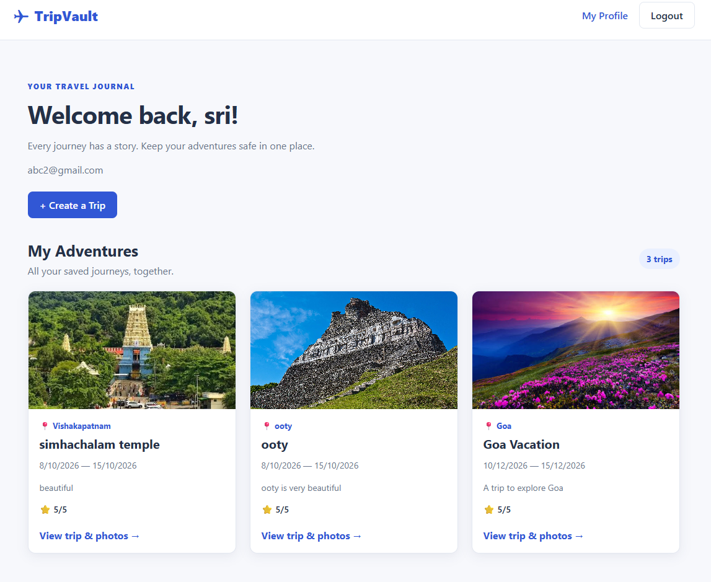
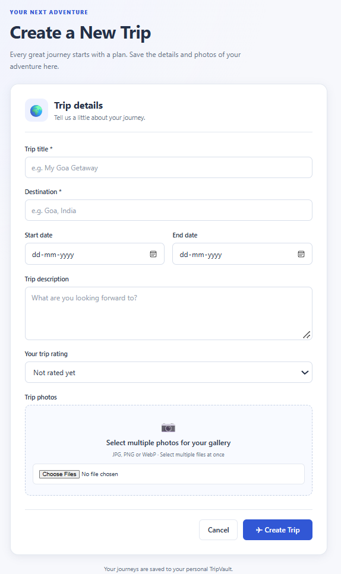
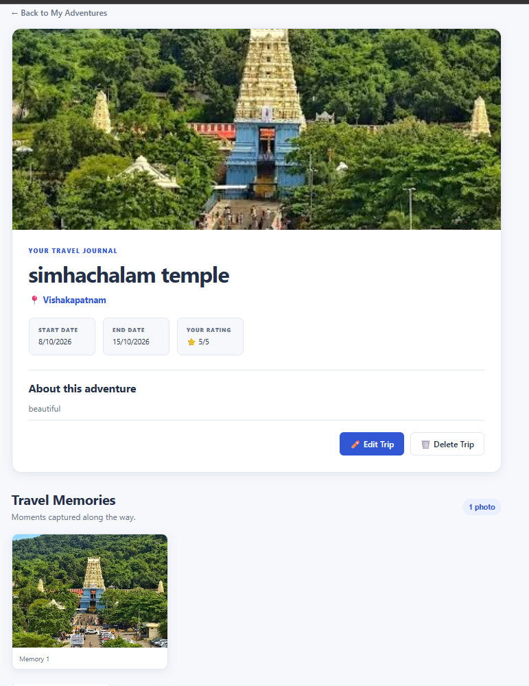
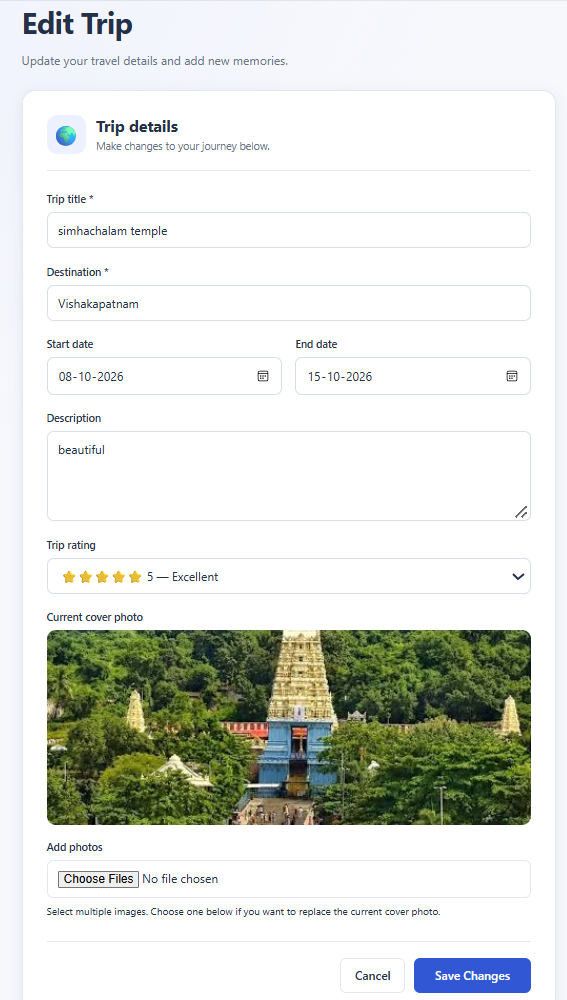

# ✈️ TripVault – Your Personal Travel Memory Journal

TripVault is a full-stack MERN travel journal application that helps users create, organize, and preserve their travel memories in one place.

Users can register, log in securely, create travel entries, upload multiple trip photos, select cover images, edit trip details, and manage their personal travel collections through a responsive interface.

🌐 **Live Application:** https://tripvault-topaz.vercel.app

💻 **GitHub Repository:** https://github.com/poshamsrija/tripvault

---

## ✨ Features

### 🔐 Authentication & Security
- User registration and login.
- Secure password hashing using bcryptjs.
- JWT-based authentication.
- Protected routes and authenticated API requests.
- User-specific trip management.
- Secure logout functionality.

### 🌍 Trip Management
- Create trips with titles and destinations.
- Add start dates, end dates, descriptions, and ratings.
- View individual trip details.
- Edit existing trip information.
- Delete trips with confirmation.
- View personal trips through the dashboard.

### 📸 Photo Management
- Upload multiple photos for a trip.
- Select a cover photo.
- Replace the existing cover photo while editing.
- Preview selected images before uploading.
- Store uploaded images using Cloudinary.
- Display trip memories in a photo gallery.

### 📱 User Experience
- Responsive interface for desktop and mobile devices.
- Mobile hamburger navigation.
- Loading and error states.
- Consistent styling across application pages.
- User-friendly forms and navigation.

---

## 🛠️ Tech Stack

| Category | Technologies |
|---|---|
| Frontend | React.js, Vite |
| Routing | React Router |
| API Requests | Axios |
| Styling | CSS |
| Backend | Node.js, Express.js |
| Database | MongoDB Atlas |
| ODM | Mongoose |
| Authentication | JWT, bcryptjs |
| Image Storage | Cloudinary |
| Environment Configuration | dotenv |
| Frontend Deployment | Vercel |
| Backend Deployment | Render |
| Version Control | Git, GitHub |

---

## 📸 Application Screenshots

### Login Page


### Dashboard


### Create Trip


### Trip Details


### Edit Trip


---

## 🚀 Live Deployment

TripVault is deployed using:

- **Frontend:** Vercel
- **Backend:** Render
- **Database:** MongoDB Atlas
- **Image Hosting:** Cloudinary

**Live Application:** https://tripvault-topaz.vercel.app

---

## ⚙️ Getting Started

Follow these instructions to run TripVault locally.

### Prerequisites

- Node.js and npm
- MongoDB Atlas account or local MongoDB instance
- Cloudinary account
- Git

### 1. Clone the Repository

```bash
git clone https://github.com/poshamsrija/tripvault.git
cd tripvault
```

### 2. Set Up the Backend

```bash
cd server
npm install
```

Create a `.env` file inside the `server` directory.

```env
PORT=5000
MONGO_URI=your_mongodb_connection_string
JWT_SECRET=your_jwt_secret

CLOUDINARY_CLOUD_NAME=your_cloudinary_cloud_name
CLOUDINARY_API_KEY=your_cloudinary_api_key
CLOUDINARY_API_SECRET=your_cloudinary_api_secret
```

Replace the placeholder values with your actual credentials. Use the exact Cloudinary environment variable names expected by your backend configuration.

Start the backend:

```bash
npm run dev
```

The backend runs at:

`http://localhost:5000`

### 3. Set Up the Frontend

Open another terminal and navigate to the client folder:

```bash
cd client
npm install
```

Create a `.env` file inside the `client` directory.

```env
VITE_API_URL=http://localhost:5000
```

Start the frontend:

```bash
npm run dev
```

Open the local URL displayed in your terminal by Vite.

---

## 🔗 API Routes

The following trip routes are available:

| Method | Endpoint | Description | Authentication |
|---|---|---|---|
| GET | `/` | API welcome message | No |
| POST | `/api/trips` | Create a trip | Yes |
| GET | `/api/trips` | Get user's trips | Yes |
| GET | `/api/trips/:id` | Get trip details | Yes |
| PUT | `/api/trips/:id` | Update trip details | Yes |
| DELETE | `/api/trips/:id` | Delete a trip | Yes |
| POST | `/api/trips/:id/upload` | Upload a trip photo | Yes |

Authentication routes are mounted under `/api/auth`.

All protected trip routes require a valid JWT in the Authorization header:

```http
Authorization: Bearer <your_jwt_token>
```

---

## 🔑 Authentication Flow

1. A user registers with their account details.
2. The backend hashes the password before saving user information.
3. The user logs in using their credentials.
4. The backend verifies the credentials and generates a JWT.
5. The frontend stores the authentication token.
6. Axios attaches the token to protected API requests.
7. Authentication middleware verifies the token before allowing access to protected resources.
8. Logging out clears the stored token.

---

## 📋 Available Scripts

### Backend

| Command | Description |
|---|---|
| `npm install` | Install backend dependencies |
| `npm run dev` | Start backend using Nodemon |
| `npm start` | Start backend using Node.js |

### Frontend

| Command | Description |
|---|---|
| `npm install` | Install frontend dependencies |
| `npm run dev` | Start Vite development server |
| `npm run build` | Create production build |
| `npm run preview` | Preview production build |
| `npm run lint` | Run ESLint checks |

---

## 🔒 Security Notes

- Keep `.env` files out of GitHub.
- Never expose MongoDB credentials, JWT secrets, or Cloudinary API secrets.
- Use environment variables for sensitive configuration.
- Protected endpoints require authentication.
- Users can manage only their own trips.

---

## 👩‍💻 Author

**Srija Posham**

B.Tech – Computer Science and Engineering

GitHub: https://github.com/poshamsrija

---

## ⭐ Acknowledgements

Built as a full-stack development project to explore modern web technologies, authentication, database integration, cloud image storage, responsive UI development, and application deployment.

**TripVault – Every journey deserves to be remembered! ✈️**